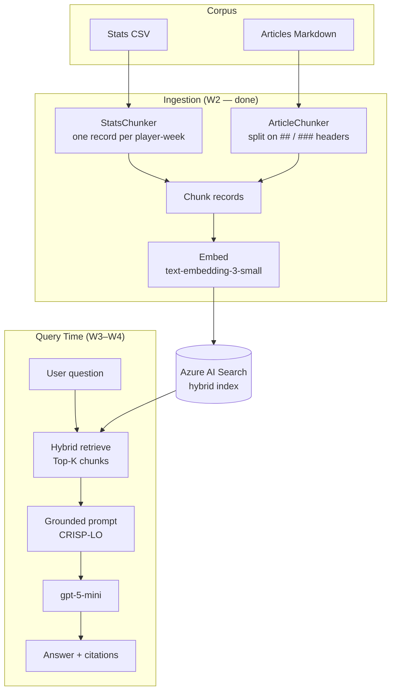
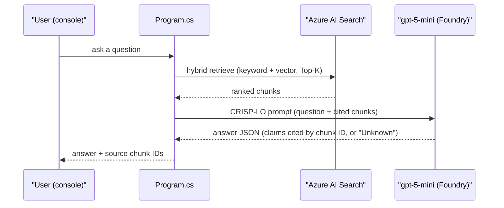
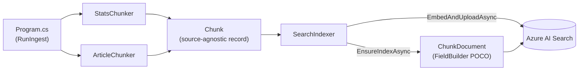

# Architecture

## Data Flow

```
Stats (CSV) + Articles (Markdown)
        │
        ▼  [Ingestion]  chunk → embed → index        (W2 — done)
  Azure AI Search
        │
   Query ──► hybrid retrieve Top-K ──► grounded prompt ──► gpt-5-mini ──► Answer   (W3–W4)
```



### Query Flow Detail (W3–W4, not yet built)



## Decisions

| Decision | Choice | Rationale |
|---|---|---|
| Chunking — stats | One text record per player-week | Atomic, retrievable, matches the data's natural grain |
| Chunking — articles | Structural split on `##`/`###` headers | Honors author structure, clean topic boundaries |
| Chunk size | ~800 chars (500–1500 range) | See `docs/chunking-decisions.md` |
| Overlap | 10–20% on prose only | Avoids mid-thought cuts; not needed on stat records |
| Embedding | `text-embedding-3-small` (start) | Cost/perf default; upgrade to `3-large` only if recall falls short |
| Search | Hybrid (keyword + vector) | Keyword for exact names, vector for semantic intent |
| Top-K | 3–5 chunks | Start at 3, expand to 5 if answers miss context |
| Orchestration | Semantic Kernel + raw Azure AI Search SDK | SK for the chat pipeline, raw SDK for full hybrid-search control |
| Platform | Microsoft Foundry, keyless (`DefaultAzureCredential`) | Unified deploys/grounding/evals; needs the Cognitive Services OpenAI User RBAC role |
| LLM | `gpt-5-mini` (GlobalStandard) | `gpt-4o`/`4.1-mini` are deprecated in `eastus2` — verified Wk1 |
| UI | Console (MVP) | Fastest path to a working system |
| Phase 3 target | Microsoft Agent Framework (`Microsoft.Agents.AI`) | Semantic Kernel's successor — not the legacy SK `Kernel` API |

## Code Structure

- **Single-file console app** (`src/Program.cs`) — a top-level-statements `switch` on `args[0]`
  dispatches to command handlers (`RunModelCheck`, `RunCorpusLoad`, `RunIngest`, ...). New
  commands follow this pattern until it outgrows a single file.
- **`src/Ingestion/`** — the chunk → embed → index pipeline: `Chunk.cs` (source-agnostic record),
  `StatsChunker.cs` / `ArticleChunker.cs` (per-source chunking rules), `ChunkDocument.cs`
  (the `FieldBuilder`-attributed POCO actually uploaded to the index), `SearchIndexer.cs`
  (index creation + embed/upload orchestration). Full build rationale in
  `docs/w2-ingestion-plan.md`.



## Config

`src/appsettings.json` is the primary source (endpoint + deployment/index names — safe to
commit, no secrets, since auth is keyless). Environment variables (`Foundry__Endpoint`,
`Foundry__ChatDeployment`, `Search__Endpoint`, `Search__IndexName`) override it, read via
`Microsoft.Extensions.Configuration`.

## Auth

Keyless everywhere — `DefaultAzureCredential`: local `az login` session in dev, managed identity
in Azure. **Never introduce API keys/secrets** for Foundry or Azure AI Search.

## Data

- `data/sample-corpus/` — committed, tiny, keeps `load`/`ingest` runnable out of the box.
- `data/corpus/` — full season snapshot, gitignored. **Never commit this.**

## Related Docs

- `docs/goals.md` — why this project exists, success criteria, milestones
- `docs/use-cases.md` — what the system actually needs to do
- `docs/chunking-decisions.md` — full chunking rules, read before touching `src/Ingestion/`
- `docs/data-sources.md` — candidate NFL stats/news data sources
- `docs/w2-ingestion-plan.md` — the as-built ingestion pipeline design
